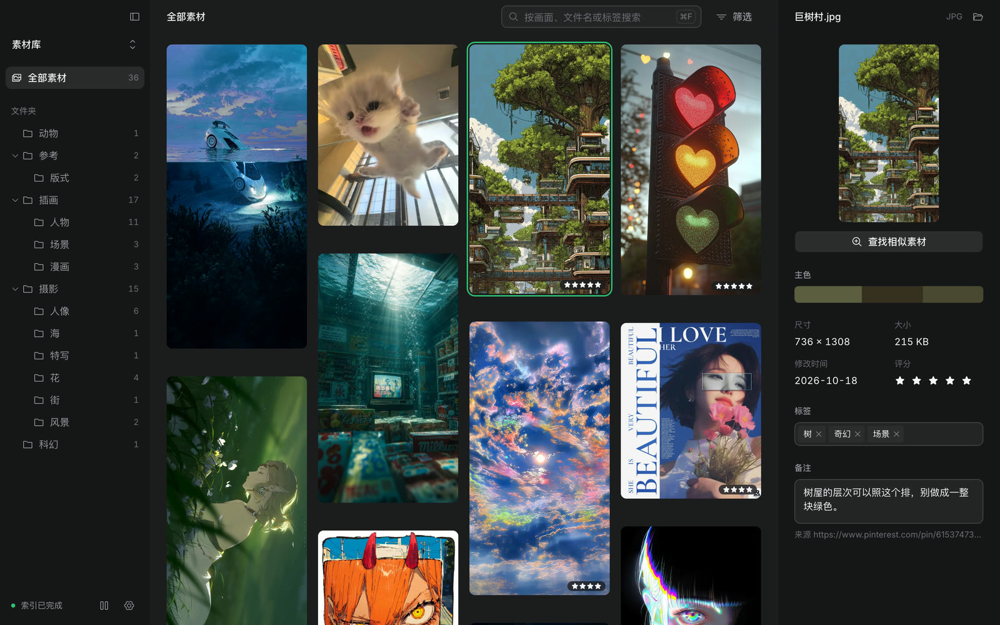
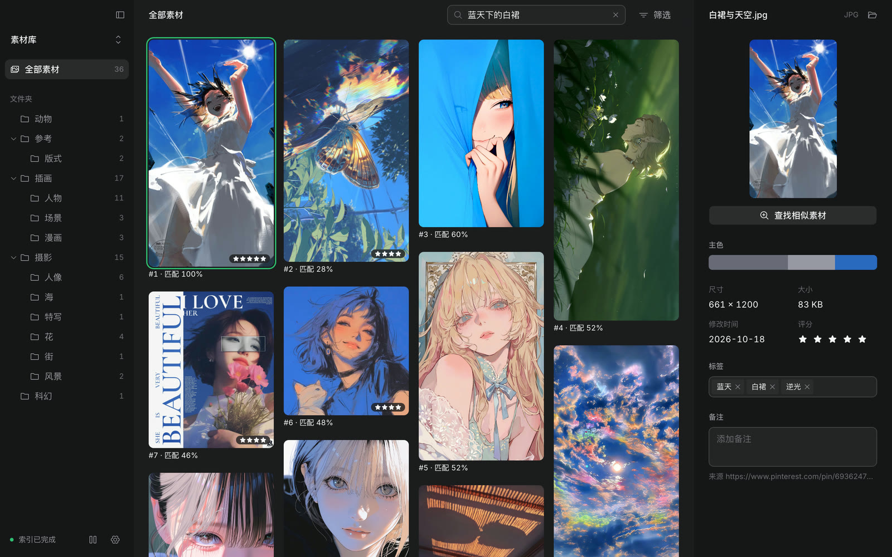
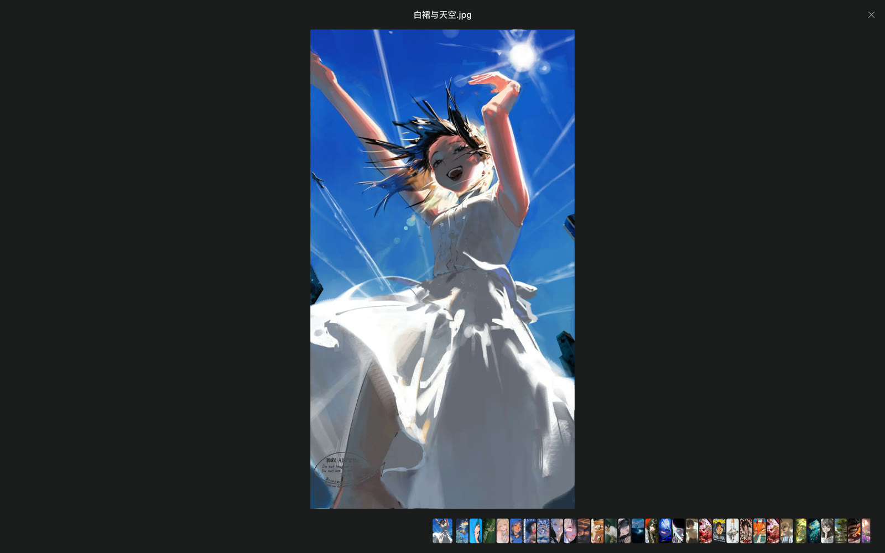
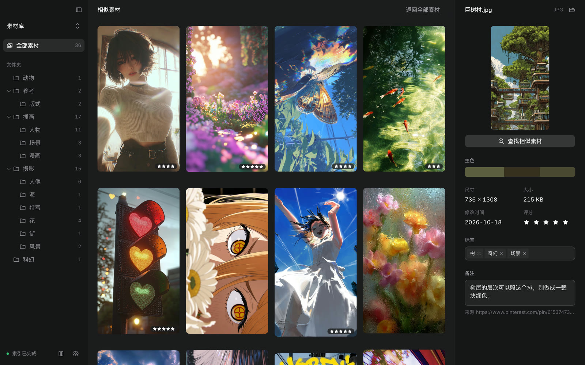
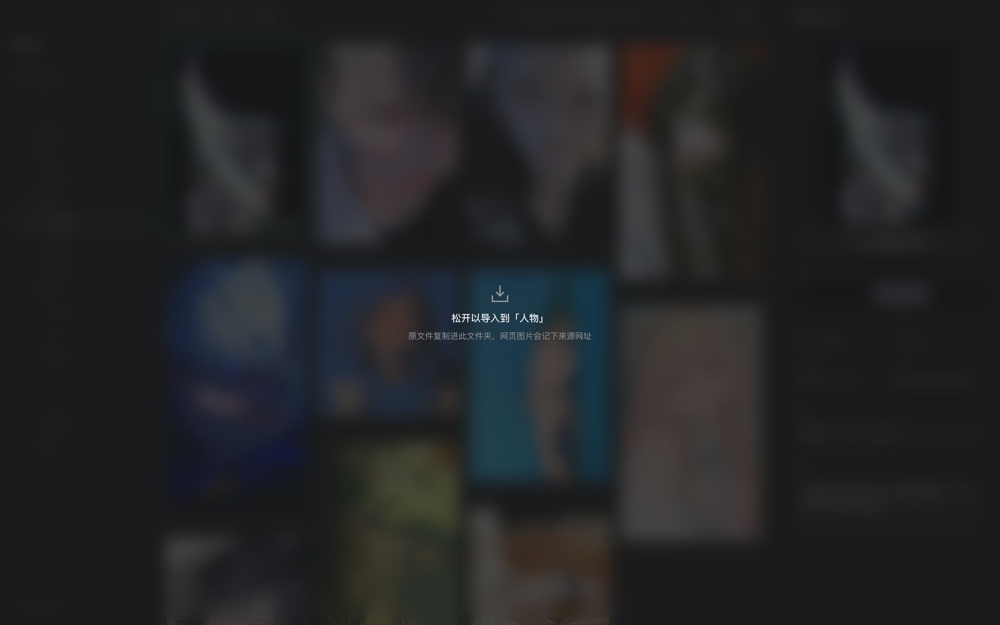
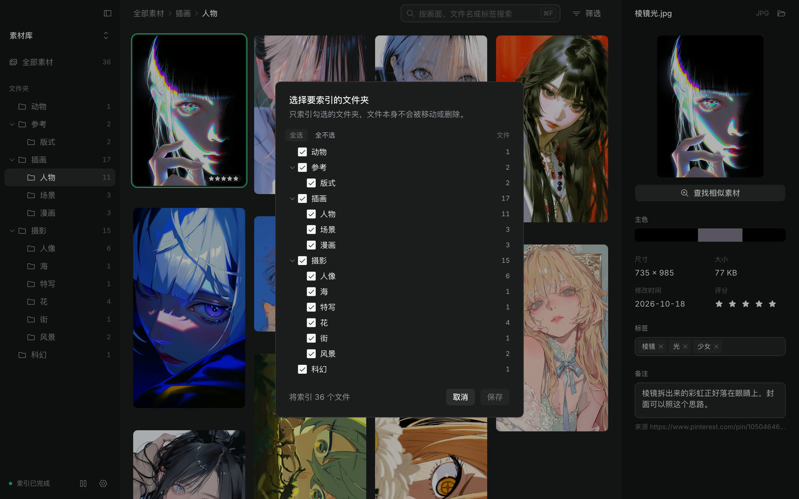
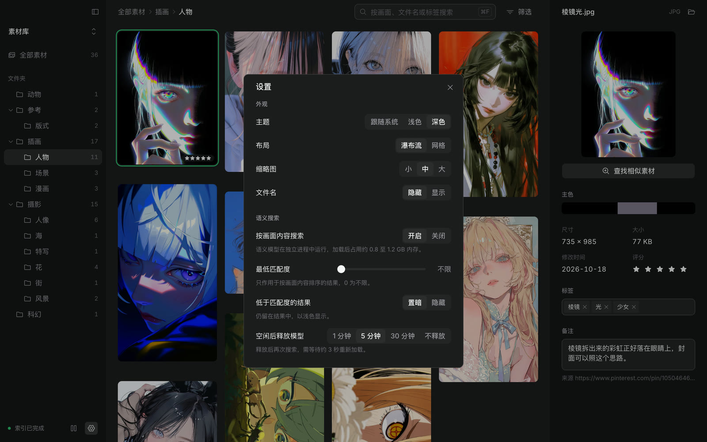
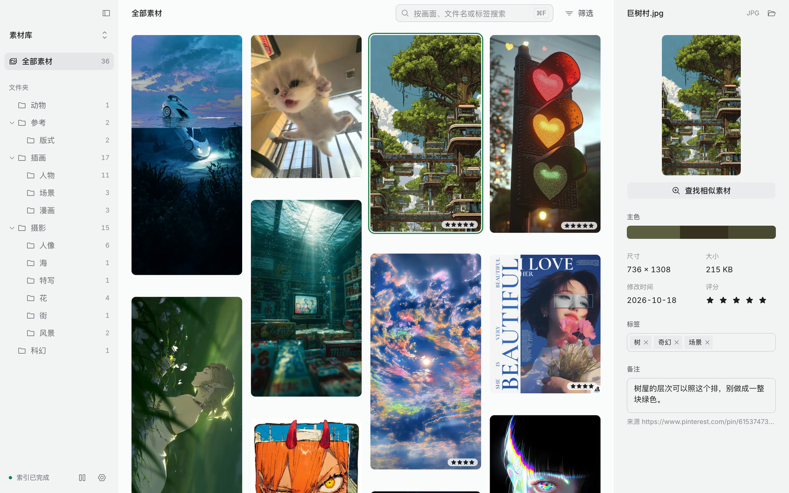
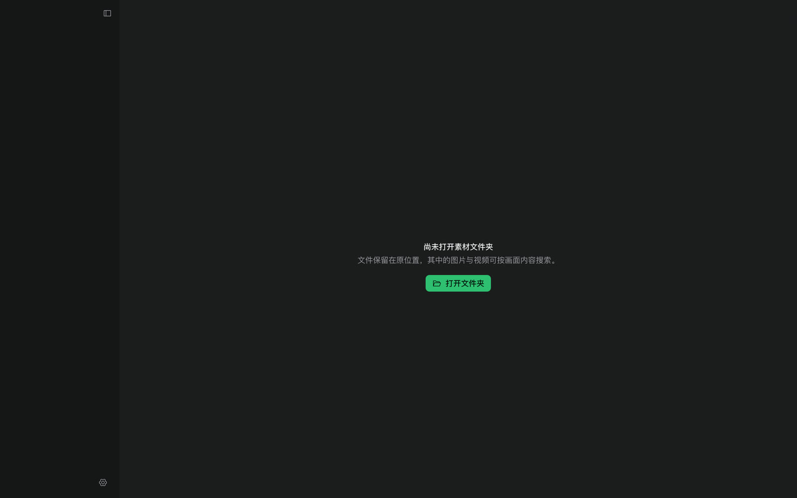

# Déjà

一个文件夹，就是素材库。

Déjà 是一个 macOS 桌面应用。它不导入、不接管、不复制你的图。你打开任意一个文件夹，它把里面的图片和视频铺成一堵墙，可以直接看、打分、贴标签、写备注，也可以按画面内容搜。所有标记都存在这个文件夹里，换台机器打开同一个文件夹，它们还在。



[](docs/mg.mp4)

32 秒宣传片，1080p，带配乐，[docs/mg.mp4](docs/mg.mp4)。上面循环的是搜索那一段。片子里的匹配度和向量分布都是本机 embeddinggemma-2 真算出来的，配乐也由脚本合成。早先那条 28 秒的截图版还在 [docs/promo.mp4](docs/promo.mp4)。片子和下面所有截图都由脚本生成，可以重跑，见脚本表。

## 它解决什么

Pinterest 收藏夹、Dribbble 点赞、截图文件夹、素材盘。图一直在硬盘上，找不回来是因为只有文件名。

Déjà 把「找到那张图」压成两件事。文件夹本身就是分类，标签和备注补上文件夹说不清的部分。搜索按画面内容和关键词一起排序，说一句「蓝天下的白裙」就能翻出来。

- **文件夹就是结构**。侧栏是磁盘上的目录树，不是另一套虚拟分类。移动、改名、删除都在访达里做，标签和备注会跟着文件走。
- **不复制文件**。缩略图、主色、感知哈希、向量都在应用缓存里，原图原地不动。
- **元数据是纯文本**。标签、评分、备注写成 Markdown frontmatter，可以 diff、可以进 Git、可以用任何编辑器改。
- **搜索在本机**。语义模型是本地进程，查询和图片都不离开这台机器。

## 截图

搜索按画面内容排序，每条带匹配度。低于最低匹配度的结果可以置暗，也可以直接隐藏。



整屏预览。双击任意一张打开，方向键翻图，底部缩略图条可以点、可以拖、可以滚。



| | |
| --- | --- |
|  |  |
| 查找相似。用一张图去找长得像的图，近似重复排第一。 | 从浏览器拖进来就复制到当前文件夹，网页图片记下来源，可定位、可撤回。 |
|  |  |
| 第一次打开文件夹先选索引范围。排除只是不进索引，文件不动。 | 设置只放两类决定。窗口长什么样，模型可以花多少内存。 |
|  |  |
| 深色是默认，浅色是一套完整主题。 | 还没打开文件夹时，它只问一件事。 |

## 怎么用

打开文件夹。首次打开会问你索引哪些子目录，之后可以在侧栏的文件夹菜单里改。索引在后台跑，侧栏底部显示进度，可以暂停。

找到一张图的四条路：

| 用法 | 做法 |
| --- | --- |
| 按画面搜 | 在搜索框输入一句话，例如「傍晚的海边」 |
| 按关键词搜 | 搜索方式切到「关键词」，只匹配文件名、标签、备注 |
| 用图找图 | 选中一张，点「查找相似素材」 |
| 顺着文件夹翻 | 点侧栏的目录，面包屑会显示你在哪一层 |

选中一张之后，右侧检视面板可以打分、贴标签、写备注。没有保存按钮，改动直接写进那份 Markdown。备注在停手 0.7 秒后落盘，写入时标题右侧显示「已保存」。

### 快捷键

| 按键 | 作用 |
| --- | --- |
| `⌘F` 或 `/` | 聚焦搜索框 |
| `1`–`5` / `0` | 给当前素材打星 / 清除评分（焦点不在输入框时） |
| `↑` `↓` `←` `→` | 在素材墙里移动选择；预览打开时翻图 |
| `Home` / `End` | 跳到第一张 / 最后一张 |
| `Enter` 或 `Space` | 打开整屏预览 |
| `Esc` | 清空搜索、退出相似素材、关闭预览 |
| `⌘,` | 设置 |

关闭窗口不会退出。应用回到菜单栏继续盯着文件夹，从菜单栏图标可以叫回窗口、打开最近的文件夹，或者退出。

## 数据放在哪里

原图、视频、目录结构都在你自己的文件夹里，Déjà 只往里多加一个隐藏目录。

```
你的素材库/
├── 插画/
│   └── 场景/巨树村.jpg
├── 摄影/
│   └── 花/紫花丛.jpg
└── .deja/
    ├── scope.json                 索引范围，{"excluded": ["摄影/人像"]}
    └── meta/
        └── 插画/场景/巨树村.jpg.md   ← 与该文件同名，加 .md
```

`.deja/meta` 里的一篇：

```markdown
---
tags: [树, 奇幻, 场景]
rating: 5
source: https://www.pinterest.com/pin/61537473.../
---

树屋的层次可以照这个排，别做成一整块绿色。
```

frontmatter 三个键，`tags`、`rating`、`source`。第二个 `---` 之后的正文就是备注，可以为空。在访达里移动或改名一张图，下次扫描时会按大小和修改时间认出它，把这篇 Markdown 搬到新路径。删掉 `.deja` 不会动到一张图，只是标签、评分和备注没了。

应用自己的缓存另存一处（macOS 上是 `~/Library/Application Support/Deja`），放缩略图、索引缓存和一个 sqlite-vec 向量库。缓存可以随时删，删掉之后重新索引。

## 怎么跑起来

需要 macOS、Node 20.19 或更新（vite 8 的要求）、Rust 工具链。语义搜索另外需要 Python 3.12 和本地模型权重，不装也能用，关掉语义搜索即可。

```bash
npm install                 # 顺带装好 git commit-msg 钩子
npm run tauri dev           # 桌面窗口，热更新
```

浏览器里调界面时，前端和 Rust 后端各起一个。后端把同一份 dispatch 暴露成 HTTP，前端在 5173 上把 `/api` 代理过去。

```bash
npm run e2e:api &           # 127.0.0.1:5177
npm run dev                 # 127.0.0.1:5173
```

桌面窗口是正常路径。浏览器模式没有文件选择器和系统集成，输入路径打开文件夹。

语义搜索的模型侧：

```bash
cd sidecar
uv venv --python 3.12 .venv
uv pip install --python .venv/bin/python -r requirements.txt
.venv/bin/python embed_server.py --port 5187 --dim 256 --offline
```

`--offline` 使用本地 Hugging Face 缓存里的权重，不会联网。细节、接口约定和实测数字在 [sidecar/README.md](sidecar/README.md)。

### 脚本

| 命令 | 作用 |
| --- | --- |
| `npm run dev` | vite 开发服务器 |
| `npm run build` | 类型检查加前端构建 |
| `npm run tauri` | Tauri CLI（`npm run tauri dev` / `build`） |
| `npm run test:unit` | 前端纯函数单测（`node --test`） |
| `npm run test:rust` | Rust 后端单测 |
| `npm run e2e` | 编译 `deja-e2e` 后台，用 Playwright 驱动真实后端跑端到端 |
| `npm run fixtures` | 从 `DEJA_FIXTURES_SOURCE` 生成测试素材库 `public/vault` |
| `npm run demo` | 从 `DEJA_DEMO_SOURCE` 生成演示素材库 `demo/素材库` |
| `npm run shots` | 在演示库上截 README 用的图，写到 `.shots/` |
| `npm run readme` | 把 `.shots/` 的截图压成 `docs/screenshots/*.jpg` |
| `npm run promo` | 逐帧渲染截图版宣传动画，输出 `docs/promo.mp4` |
| `node scripts/make-mg-assets.mjs` | 从 `DEJA_VAULT`（默认 `~/Documents/Deja Vault`）取图，用本机模型算匹配度和二维分布，写到 `promo/.vault/` |
| `npm run mg` | 合成配乐，逐帧渲染宣传片，输出 `docs/mg.mp4` 和 `docs/mg.gif` |
| `npm run media` | 上面三步一起跑 |

## 测试

三层，各自证明不同的事。

- **单测**（`npm run test:unit`）覆盖纯函数，落位、筛选、范围树、空态文案、索引状态。
- **Rust 测试**（`npm run test:rust`）覆盖元数据读写、索引范围、导入、检索排序、向量库、模型客户端。
- **端到端**（`npm run e2e`）用 Playwright 打开真实页面，后面是真 Rust 后端（`src-tauri/src/bin/e2e_server.rs` 把同一份 dispatch 暴露成 HTTP），所以测的是应用，不是替身。素材来自 `npm run fixtures` 生成的 12 张图，拖放、相似、预览、范围、设置都有用例。

截图和宣传动画不是手截的。`e2e/shots.spec.ts` 打开演示库、等索引完成、走到各个状态再截图；`promo/promo.html` 是一条时间线，页面里的 `window.__render(t)` 是 t 的纯函数，`scripts/make-promo.mjs` 逐帧求值后把 PNG 直接送进 ffmpeg。同一份输入，任何时候重跑都是同一段片子。`promo/mg.html` 同理，它的图和分数来自 `promo/.vault/`，这个目录取自本地素材库，不进仓库，所以重跑宣传片需要先在自己的库上跑一遍 `make-mg-assets.mjs`。

## 目录

```
src/              前端。按功能切：browse、wall、inspector、viewer、scope、import、settings
src/app/          会话状态与会话机（单 store，reducer 决定哪些事件在哪个阶段被接受）
src-tauri/src/    后端。scan 扫描、thumb 缩略图、color 主色、meta Markdown、scope 范围、
                  search 排序、vectors sqlite-vec、model 模型进程、import 导入、tray 菜单栏
sidecar/          Python 嵌入服务，一个进程一个模型，串行推理
e2e/              Playwright 用例；shots.spec.ts 产图
scripts/          素材库、截图、宣传动画的生成脚本
promo/            宣传动画的时间线页面；mg.html 是带配乐的宣传片
docs/             README 的截图和宣传动画
design/           globals.css、图标
DESIGN.md         设计语言：颜色、字阶、间距、组件差异、动效规则
```

## 边界

诚实说明，不打算藏。

- **只做过 macOS**。菜单栏图标、红绿灯位置、`titleBarStyle: Overlay` 都是 macOS 的写法。
- **语义搜索需要 Python 环境**。没有模型时按关键词排序，界面会说明原因。
- **音频不索引**。视频能扫、能预览、能播，音频文件不进素材墙。
- **模型是单例**。一个模型进程占 0.8 到 1.2 GB 内存，可以在设置里让它空闲后释放，代价是下次搜索多等约 3 秒。
- **没有云**。没有账号、没有同步、没有遥测。备份就是把文件夹拷走。

## 设计

界面按 [DESIGN.md](DESIGN.md) 来。深色是默认，颜色走 shadcn 的语义名，深浅只靠明度台阶，阴影全部清零，翡翠绿只留给一个主按钮、焦点和成功状态。

## 许可

未发布。仓库里的演示图片来自 Pinterest 收藏，仅用于截图与动画，不随产品分发。
